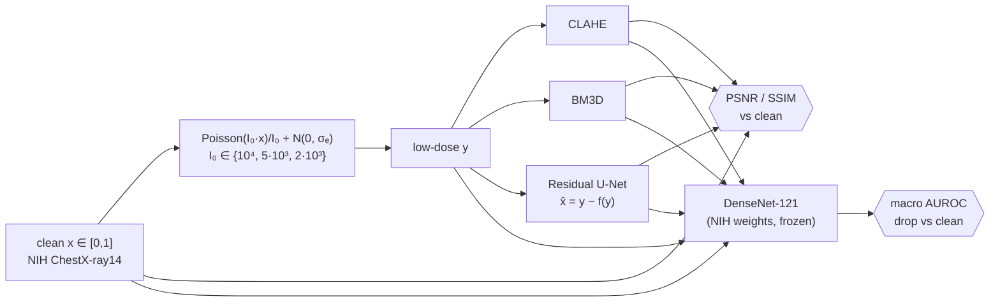
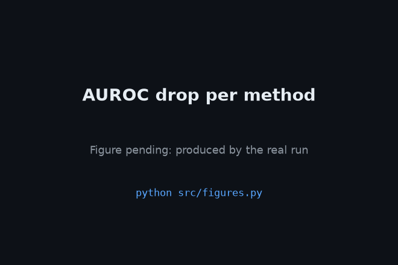
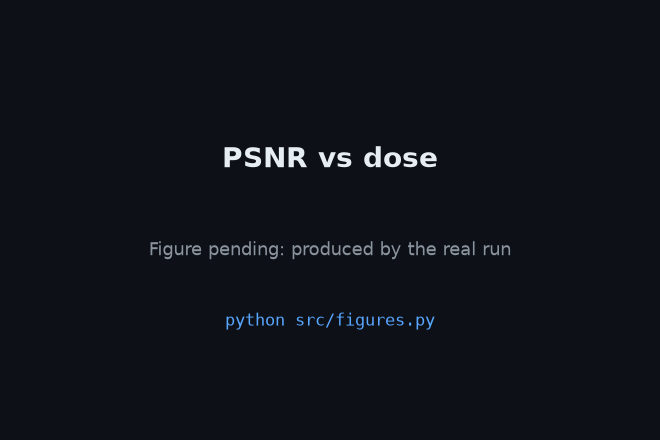

<div align="center">

# 🩻 XRayRestore

### Denoising low-dose chest X-rays without erasing the diagnosis

**A residual U-Net denoiser, judged on PSNR and SSIM and also on whether a pathology classifier still works on its output**

[](https://github.com/Utkarsh-Aggarwal/XRayRestore/actions/workflows/tests.yml)


[](LICENSE)


</div>

---

## The problem

Every X-ray costs the patient radiation. **Cutting the dose cuts the risk, but it adds quantum noise**, and noisy images are harder to read. Denoisers help, but a high-PSNR denoiser can still *smooth away a small nodule or a faint infiltrate*. For a medical image, looking clean isn't the goal. The goal is that **the diagnostic information survives**.

**XRayRestore measures both.** It reports the usual image-quality metrics (PSNR, SSIM) and a **diagnostic-fidelity test**: a pretrained NIH DenseNet-121 pathology classifier is run on the clean, noisy and restored versions of the same test images, and the report shows how much of the classifier's AUROC each method keeps.

> 📌 **Status:** the pipeline is complete and unit-tested (CI above). The result tables are filled by `bash scripts/run_all.sh` once the NIH data has been downloaded with *your* Kaggle key. They are **left empty on purpose until that run finishes. Every number will come from `results/*.csv`, and nothing here is made up.**

<p align="center"></p>

---

## ✨ What's inside

| | |
|---|---|
| ☢️ **Physically motivated noise** | Poisson photon counting plus Gaussian electronic noise, at 3 dose levels |
| 🧬 **Residual U-Net** | 4 levels (32→256 channels), predicts the *noise*: `x̂ = y − f(y)` |
| 🎯 **Composite loss** | `L1 + 0.2·(1−SSIM) + 0.05·VGG16-relu2_2 perceptual`, every weight configurable |
| 🧪 **Strong baselines** | CLAHE and BM3D (σ estimated per image) |
| 🩺 **Diagnostic fidelity** | Per-pathology AUROC drop with `torchxrayvision`'s NIH DenseNet-121 |
| 🔒 **No leakage** | Train/val/test split by **patient ID**; fixed-seed test noise, so every method sees identical inputs |
| 🧾 **Auto-reporting** | `results/summary.md` and every figure are generated from the CSVs |

---

## 🏗️ Pipeline



### Low-dose simulation

```python
counts = Poisson(I0 * x)                 # photon shot noise: lower I0 means noisier
y      = clip(counts / I0 + N(0, σe), 0, 1)    # σe = 0.01 electronic noise
```

During training the dose is drawn at random **for each batch**, which works as augmentation. For val and test the noise is seeded deterministically by (image, dose), so every method is scored on exactly the same noisy pixels.

### Model and training

Residual U-Net with channels (32, 64, 128, 256) and BatchNorm, output clamped to [0, 1]. AdamW, learning rate 2e-4 with cosine decay, batch size 16, 256×256 inputs, horizontal flips, 40 epochs. **The checkpoint is chosen by validation SSIM at the lowest dose.**

### Diagnostic-fidelity protocol

1. `xrv.models.DenseNet(weights="densenet121-res224-nih")`, preprocessed exactly as torchxrayvision expects: `xrv.datasets.normalize` to [-1024, 1024], single channel, `XRayResizer(224)`.
2. Per-pathology AUROC against the NIH labels, counting only pathologies in `model.pathologies` with **at least 10 positive cases** in the test split, then macro-averaged.
3. **AUROC drop = AUROC(clean) − AUROC(method)**. Lower is better, and 0 means no diagnostic information was lost.

---

## 📊 Results

> Filled from [`results/image_quality.csv`](results/image_quality.csv) and [`results/diagnostic_fidelity.csv`](results/diagnostic_fidelity.csv). The full auto-generated tables are in [`results/summary.md`](results/summary.md).

### Image quality (test split)

| Dose I₀ | Noisy PSNR / SSIM | CLAHE | BM3D | **U-Net (ours)** |
|:-:|:-:|:-:|:-:|:-:|
| 10 000 | ⏳ | ⏳ | ⏳ | ⏳ |
| 5 000 | ⏳ | ⏳ | ⏳ | ⏳ |
| 2 000 | ⏳ | ⏳ | ⏳ | ⏳ |

### 🩺 Diagnostic fidelity: the headline

| Dose I₀ | Clean AUROC | Noisy Δ | CLAHE Δ | BM3D Δ | **U-Net Δ** |
|:-:|:-:|:-:|:-:|:-:|:-:|
| 10 000 | ⏳ | ⏳ | ⏳ | ⏳ | ⏳ |
| 5 000 | ⏳ | ⏳ | ⏳ | ⏳ | ⏳ |
| 2 000 | ⏳ | ⏳ | ⏳ | ⏳ | ⏳ |

<p align="center">
  
  
</p>

### Loss ablation

| Loss | Val SSIM | AUROC drop @ I₀=2000 |
|---|:-:|:-:|
| L1 only | ⏳ | ⏳ |
| L1 + SSIM | ⏳ | ⏳ |
| **L1 + SSIM + perceptual (full)** | ⏳ | ⏳ |

BM3D is slow, so it runs on the first `eval.bm3d_max_images` (default 500) test images. The `n_images` column of each CSV gives the exact count, and BM3D's AUROC drop is measured against clean images on that same subset.

---

## 🚀 Reproduce

```bash
git clone https://github.com/Utkarsh-Aggarwal/XRayRestore && cd XRayRestore
python -m venv .venv && source .venv/bin/activate
pip install -r requirements.txt
pytest -q                                   # noise + model tests, no data needed
```

1. Put **your own** Kaggle API token at `~/.kaggle/kaggle.json` (kaggle.com → Settings → API). Never paste it into code or chat.
2. Then run:

```bash
bash scripts/download_data.sh               # NIH ChestX-ray14 random sample (~5.6k images)
python scripts/make_splits.py data          # patient-level 80/10/10 → data/splits.csv
bash scripts/run_all.sh                     # train → evaluate → ablations → figures + summary.md
```

Training goes much faster on a GPU. Free Colab and Kaggle GPUs are enough. Device selection is automatic (CUDA, then MPS, then CPU). Seed 0 is used everywhere.

**Weights:** `best.pt` is published as a [GitHub Release asset](https://github.com/Utkarsh-Aggarwal/XRayRestore/releases) and is never committed.

---

## ⚠️ Limitations (read these)

- **The low dose is simulated, not real.** Real low-dose scanners also add detector effects and scatter that this noise model leaves out.
- **Single-dataset test set.** It is a subset of NIH ChestX-ray14 with no external validation.
- **In-distribution classifier.** The DenseNet was trained on NIH data, so this fidelity check is optimistic compared with a classifier from another hospital.
- NIH labels were mined from radiology reports by NLP and are known to be noisy.
- **This is a research project, not a medical device, and it is not for clinical use.**

---

## 📁 Layout

```
XRayRestore/
├── configs/default.yaml     # doses, model, loss weights, training, ablations
├── scripts/  download_data.sh · make_splits.py · run_all.sh
├── src/
│   ├── noise.py             # Poisson-Gaussian simulation + deterministic test noise
│   ├── model.py             # residual U-Net
│   ├── losses.py            # L1 + SSIM + VGG perceptual
│   ├── baselines.py         # CLAHE, BM3D
│   ├── train.py · evaluate.py · figures.py · data.py
├── tests/    test_noise.py (range, dose↔variance, determinism) · test_model.py
└── results/  CSVs, summary.md, figures/
```

## 📚 Citation & license

```bibtex
@inproceedings{wang2017chestxray,
  title     = {ChestX-ray8: Hospital-scale Chest X-ray Database and Benchmarks on Weakly-Supervised Classification and Localization of Common Thorax Diseases},
  author    = {Wang, Xiaosong and Peng, Yifan and Lu, Le and Lu, Zhiyong and Bagheri, Mohammadhadi and Summers, Ronald M.},
  booktitle = {CVPR},
  year      = {2017}
}
@inproceedings{cohen2022xrv,
  title     = {TorchXRayVision: A library of chest X-ray datasets and models},
  author    = {Cohen, Joseph Paul and Viviano, Joseph D. and Bertin, Paul and others},
  booktitle = {Medical Imaging with Deep Learning},
  year      = {2022}
}
```

The code is **MIT** licensed. NIH ChestX-ray14 is provided by the NIH Clinical Center (CC0 on Kaggle). Cite the dataset paper above, and note that the dataset is not redistributed here.
